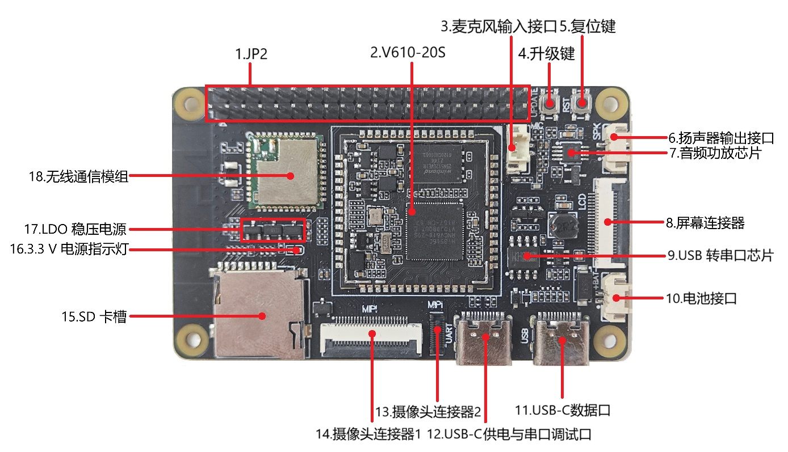
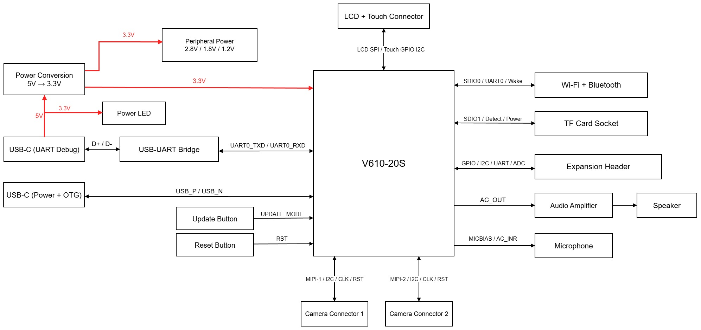

# Cove-610 硬件说明

Cove-610 开发板面向嵌入式视觉、音频和边缘 AI 原型验证，搭载 V610-20S 核心模组，板载 Wi-Fi/BLE、TF 卡座、两路 MIPI 摄像头接口、LCD/触摸接口、USB-C 供电与数据接口、UART0 串口、麦克风和扬声器接口，并通过 JP2 排针引出 GPIO、I2C、UART、ADC 等扩展信号。

原理图见 [Cove-610_V1.1.pdf](../hardware/Cove-610_V1.1.pdf)。首次上电和烧录步骤见[快速上手](quickstart.md)。

## 板载组件

下表按图中编号介绍开发板正面的主要组件。

| **组件编号** | **主要组件**            | **介绍**                                                                                                        |
| ------------------ | ----------------------------- | --------------------------------------------------------------------------------------------------------------------- |
| 1                  | JP2（扩展排针）               | 引出 GPIO、I2C、UART、ADC 等信号，便于外接。详细针脚定义见[JP2 扩展排针](#jp2-扩展排针)。                  |
| 2                  | V610-20S（核心模组）          | 板载 V610-20S 核心模组，负责系统控制、视频、音频和外设接口。                                                          |
| 3                  | 麦克风输入接口（MIC）         | 用于连接外接麦克风，信号接入主控音频输入。                                                                            |
| 4                  | 升级键（UPDATE）              | 按住后重新上电进入 USB 烧录模式，见[进入 USB 烧录模式](burntool.md#进入-usb-烧录模式)。                                                      |
| 5                  | 复位键（RST）                 | 按下后复位主控系统。                                                                                                  |
| 6                  | 扬声器输出接口（SPK）         | 用于连接外接扬声器，由板载音频功放驱动。                                                                              |
| 7                  | 音频功放芯片                  | NS4150 音频功放，用于放大主控音频输出并驱动扬声器。                                                                   |
| 8                  | 屏幕连接器（LCD）             | 连接 SPI LCD 显示和触摸屏相关信号。详细针脚定义见[LCD 与触摸连接器](#lcd-与触摸连接器)。                           |
| 9                  | USB 转串口芯片（USB-to-UART） | CH340N 将 USB1 的 USB 数据转换为 UART0 串口信号，用于启动日志和串口调试。                                              |
| 10                 | 电池接口（JP5，外部 5 V 输入） | 图中标注为电池接口；电路上 Pin 1 为 `IN_5V`、Pin 2 为 GND，经 D2 接入主 5 V 母线。                                  |
| 11                 | USB-C 数据口（USB2）          | 用于 USB BootROM 烧录和 USB RNDIS 网络。                                                                         |
| 12                 | USB-C 供电与串口调试口（USB1） | 为开发板供电，并通过 CH340N 提供 UART0 启动日志和串口调试。                                                          |
| 13                 | 摄像头连接器 2（MIPI-2）      | 第二路摄像头 FPC 接口，提供 MIPI、I2C、时钟和复位信号。详细针脚定义见[MIPI-2 摄像头连接器](#mipi-2-摄像头连接器)。 |
| 14                 | 摄像头连接器 1（MIPI-1）      | 第一路摄像头 FPC 接口，提供 MIPI、I2C、时钟和复位信号。详细针脚定义见[MIPI-1 摄像头连接器](#mipi-1-摄像头连接器)。 |
| 15                 | SD 卡槽（TF/microSD）         | 用于 TF/microSD 存储扩展，连接主控 SDIO1 接口；与 LCD 共用引脚，见[LCD 与 SD 卡](quickstart.md#lcd-与-sd-卡)。                                                                       |
| 16                 | 3.3 V 电源指示灯              | 开发板建立 VDD3V3 电源后，红色 LED1 点亮。                                                                            |
| 17                 | LDO 稳压电源                  | EM6211A 系列 LDO 生成 2.8 V、1.8 V 和 1.2 V 电源轨。                                                                  |
| 18                 | 无线通信模组                  | 板载 Wi-Fi/蓝牙模组，通过 SDIO0、UART0 等信号连接主控。                                                               |

## 功能框图

外围框表示接口或板载功能模块，中心为主控模组。

## 电源选项

通过 USB1 为开发板供电，同时使用该接口进行 UART0 串口调试。USB2 用于 USB BootROM 烧录和 USB RNDIS 网络。

- JP5 的 `IN_5V`/GND 两针可作为外部 5 V 电源输入；接入前应确认极性、电压和供电能力。
- VDD3V3 是模组、Wi-Fi、TF 和 I/O 的主电源；摄像头接口还使用 2.8 V、1.8 V 和 1.2 V 电源轨。

## Pin 1 标记

在开发板正面，JP2、MIPI-1、MIPI-2 和 LCD 连接器附近的白色圆点或白色三角形，表示该连接器的 Pin 1。连接排针、FPC 或排线时，必须使线材的 Pin 1 端与该标记对齐；不要按图片左右位置、连接器文字方向或线缆朝向猜测针序。

## JP2 扩展排针

下表列出了开发板 JP2 排针的名称和功能。针脚序号与原理图一致。接线前请先按板上 Pin 1 标记确认方向。

| **序号** | **名称**      | **类型** | **功能**                                                       |
| -------------- | ------------------- | -------------- | -------------------------------------------------------------------- |
| 1              | VDD3V3              | P              | 3.3 V 主电源轨。连接外部负载前确认电流需求，避免向开发板反灌电。     |
| 2              | GND                 | G              | 地。                                                                 |
| 3              | VDD3V3              | P              | 3.3 V 主电源轨。                                                     |
| 4              | GND                 | G              | 地。                                                                 |
| 5              | VDD3V3              | P              | 3.3 V 主电源轨。                                                     |
| 6              | GND                 | G              | 地。                                                                 |
| 7              | VBAT_RTC            | P              | RTC 备份电源网络；仅按核心模组规格使用。                             |
| 8              | GND                 | G              | 地。                                                                 |
| 9              | ETH_MIDI_B_P        | DIFF           | 以太网 MDI B+ 差分信号；与 Pin 10 构成差分对。                       |
| 10             | ETH_MIDI_B_N        | DIFF           | 以太网 MDI B- 差分信号；与 Pin 9 构成差分对。                        |
| 11             | ETH_MIDI_A_P        | DIFF           | 以太网 MDI A+ 差分信号；与 Pin 12 构成差分对。                       |
| 12             | ETH_MIDI_A_N        | DIFF           | 以太网 MDI A- 差分信号；与 Pin 11 构成差分对。                       |
| 13             | CSI_I2C0_SDA        | I/O            | I2C0 数据线（`/dev/i2c-0`），由 VDD1V8 上拉。                        |
| 14             | CSI_I2C0_SCL        | I/O            | I2C0 时钟线（`/dev/i2c-0`），由 VDD1V8 上拉。                        |
| 15             | CSI_SENSOR1_RSTN    | O              | 摄像头 1 复位。                                                      |
| 16             | CSI_SENSOR0_RSTN    | O              | 摄像头 0 复位。                                                      |
| 17             | LCD_TP_RST/ADC_CH0  | I/O            | 触摸复位，复用 ADC 通道 0。                                          |
| 18             | LCD_TP_INT/ADC_CH1  | I/O            | 触摸中断，复用 ADC 通道 1。                                          |
| 19             | LCD_TP_SDA/UART1_TXD | I/O           | 触摸 I2C 数据（GPIO 模拟），复用 UART1_TXD。                         |
| 20             | LCD_TP_SCL/UART1_RXD | I/O           | 触摸 I2C 时钟（GPIO 模拟），复用 UART1_RXD。                         |
| 21             | LCD_TE/SDIO1_D3     | I              | LCD TE 同步信号。                                                    |
| 22             | LCD_SW/SDIO1_D2     | O              | LCD 背光开关。                                                       |
| 23             | LCD_DC/SDIO1_CLK    | I/O            | LCD 命令/数据选择。                                                  |
| 24             | LCD_RESET/SDIO1_CMD | O              | LCD 复位。                                                           |
| 25             | SDIO1_D1            | I/O            | SDIO1 D1。                                                           |
| 26             | LCD_SPI_MOSI/SDIO1_D0 | I/O          | LCD 串行数据。                                                       |
| 27             | LCD_SPI_CS/SDIO1_CARD_PWR_EN | O     | LCD 片选；复用 SDIO1 卡电源使能。                                    |
| 28             | LCD_SPI_SCK/SDIO1_CARD_DETECT | O    | LCD 串行时钟；复用 SDIO1 卡检测。                                    |
| 29             | UART0_TXD           | O              | UART0 发送；同时接到 USB-C 串口调试电路，勿与外部发送端直接并联。    |
| 30             | UART0_RXD           | I              | UART0 接收；同时接到 USB-C 串口调试电路。                            |
| 31             | UPDATE_MODE         | I              | 升级模式控制信号；与 UPDATE 按键关联。                               |
| 32             | SYS_RSTN_OUT        | O              | 系统复位输出信号。                                                   |
| 33             | SDIO0_DETECT        | I/O            | SDIO0 卡检测。                                                       |
| 34             | SDIO0_PWR_EN        | O              | SDIO0 电源使能。                                                     |
| 35             | AC_OUT              | AO             | 模拟音频输出至板载功放；不要直接接地。                               |
| 36             | AC_MICBIAS          | AP             | 麦克风偏置电压输出。                                                 |
| 37             | AC_INL_P            | AI             | 左声道差分麦克风输入正端。                                           |
| 38             | AC_INL_N            | AI             | 左声道差分麦克风输入负端。                                           |
| 39             | AC_INR_P            | AI             | 右声道差分麦克风输入正端。                                           |
| 40             | AC_INR_N            | AI             | 右声道差分麦克风输入负端。                                           |

类型说明：P 为电源，G 为地，I/O 为复用数字信号，I/O 的实际方向由 pinmux 和驱动决定；DIFF 为以太网差分信号，AO/AP/AI 分别为模拟输出、模拟偏置和模拟输入，NC 为未连接。

## MIPI-1 摄像头连接器

MIPI-1 为 24 针摄像头接口，使用 CK0、D0、D2 差分对；摄像头控制使用 CV610 I2C0（`/dev/i2c-0`）。

| **序号** | **名称** | **类型** | **功能**                                        |
| -------------- | -------------- | -------------- | ----------------------------------------------------- |
| 1              | NC             | NC             | 原理图未连接。                                        |
| 2              | VDD2V8         | P              | 摄像头 2.8 V 电源。                                   |
| 3              | GND            | G              | 地。                                                  |
| 4              | VDD1V8         | P              | 摄像头 1.8 V 电源。                                   |
| 5              | GND            | G              | 地。                                                  |
| 6              | VDD1V2         | P              | 摄像头 1.2 V 电源。                                   |
| 7              | GND            | G              | 地。                                                  |
| 8              | I2C0_SDA       | I/O            | 摄像头控制数据线；使用 CV610 I2C0（`/dev/i2c-0`）。 |
| 9              | I2C0_SCL       | I/O            | 摄像头控制时钟线；使用 CV610 I2C0（`/dev/i2c-0`）。 |
| 10             | NC             | NC             | 原理图未连接。                                        |
| 11             | SENSOR0_RSTN   | O              | 摄像头 0 复位。                                                       |
| 12             | GND            | G              | 地。                                                  |
| 13             | SENSOR0_CLK    | O              | 摄像头 0 外部参考时钟。                               |
| 14             | GND            | G              | 地。                                                  |
| 15             | MIPI_RX_CK0_N  | DIFF           | MIPI-1 时钟差分对 N。                                 |
| 16             | MIPI_RX_CK0_P  | DIFF           | MIPI-1 时钟差分对 P。                                 |
| 17             | GND            | G              | 地。                                                  |
| 18             | MIPI_RX_D0_N   | DIFF           | MIPI-1 数据 D0 差分对 N。                             |
| 19             | MIPI_RX_D0_P   | DIFF           | MIPI-1 数据 D0 差分对 P。                             |
| 20             | GND            | G              | 地。                                                  |
| 21             | NC             | NC             | 原理图未连接。                                        |
| 22             | MIPI_RX_D2_N   | DIFF           | MIPI-1 数据 D2 差分对 N。                             |
| 23             | MIPI_RX_D2_P   | DIFF           | MIPI-1 数据 D2 差分对 P。                             |
| 24             | GND            | G              | 地。                                                  |

## MIPI-2 摄像头连接器

MIPI-2 为 24 针摄像头接口，使用 CK1、D1、D3 差分对；摄像头控制使用 CV610 I2C1（`/dev/i2c-1`）。

| **序号** | **名称**      | **类型** | **功能**                              |
| -------------- | ------------------- | -------------- | ------------------------------------------- |
| 1              | GND                 | G              | 地。                                        |
| 2              | NC                  | NC             | 原理图未连接。                                          |
| 3              | MIPI_RX_CK1_P       | DIFF           | MIPI-2 时钟差分对 P。                       |
| 4              | SENSOR1_CLK         | O              | 摄像头 1 外部参考时钟。                     |
| 5              | MIPI_RX_CK1_N       | DIFF           | MIPI-2 时钟差分对 N。                       |
| 6              | GND                 | G              | 地。                                        |
| 7              | GND                 | G              | 地。                                        |
| 8              | SENSOR1_RSTN        | O              | 摄像头 1 复位。                                         |
| 9              | MIPI_RX_D1_P        | DIFF           | MIPI-2 数据 D1 差分对 P。                   |
| 10             | GND                 | G              | 地。                                        |
| 11             | MIPI_RX_D1_N        | DIFF           | MIPI-2 数据 D1 差分对 N。                   |
| 12             | I2C1_SCL            | I/O            | 摄像头控制时钟线；使用 CV610 I2C1（`/dev/i2c-1`）。 |
| 13             | GND                 | G              | 地。                                        |
| 14             | I2C1_SDA            | I/O            | 摄像头控制数据线；使用 CV610 I2C1（`/dev/i2c-1`）。 |
| 15             | MIPI_RX_D3_P        | DIFF           | MIPI-2 数据 D3 差分对 P。                   |
| 16             | GND                 | G              | 地。                                        |
| 17             | MIPI_RX_D3_N        | DIFF           | MIPI-2 数据 D3 差分对 N。                   |
| 18             | VDD1V8              | P              | 摄像头 1.8 V 电源。                         |
| 19             | GND                 | G              | 地。                                        |
| 20             | VDD1V8              | P              | 摄像头 1.8 V 电源。                         |
| 21             | VDD1V2              | P              | 摄像头 1.2 V 电源。                         |
| 22             | VDD2V8              | P              | 摄像头 2.8 V 电源。                         |
| 23             | VDD1V2              | P              | 摄像头 1.2 V 电源。                         |
| 24             | VDD2V8              | P              | 摄像头 2.8 V 电源。                         |

## LCD 与触摸连接器

LCD 连接器为 18 针，包含 LCD 串行显示信号、背光阴极、TE 同步以及触摸控制器信号。屏幕 FPC 直接接入此连接器，
不需要通过 JP2 杜邦线转接。TP_SCL/TP_SDA 是 GPIO 软件模拟 I2C，不是 I2C0/I2C1 硬件 I2C。

| **序号** | **名称** | **类型** | **功能**                        |
| -------------- | -------------- | -------------- | ------------------------------------- |
| 1              | GND            | G              | 地。                                  |
| 2              | LCD_RESET      | O              | LCD 复位。                            |
| 3              | LCD_SPI_SCK    | O              | LCD 串行时钟。                        |
| 4              | LCD_DC         | I/O            | LCD 命令/数据选择。                   |
| 5              | LCD_SPI_CS     | O              | LCD 片选。                            |
| 6              | LCD_SPI_MOSI   | I/O            | LCD 串行数据。                        |
| 7              | LCD_TE         | I              | LCD TE 同步信号。                     |
| 8              | GND            | G              | 地。                                  |
| 9              | VDD3V3         | P              | LCD 3.3 V 电源。                      |
| 10             | VDD3V3         | P              | LCD 3.3 V 电源。                      |
| 11             | VDD3V3         | P              | LCD 3.3 V 电源。                      |
| 12             | LCD_LEDK       | O              | 背光阴极/低端开关端，不是背光正电源。 |
| 13             | VDD3V3         | P              | LCD 3.3 V 电源。                      |
| 14             | LCD_TP_INT     | I              | 触摸控制器中断。                      |
| 15             | LCD_TP_RST     | O              | 触摸控制器复位。                      |
| 16             | LCD_TP_SDA     | I/O            | 触摸数据；由 GPIO 软件模拟 I2C。      |
| 17             | LCD_TP_SCL     | I/O            | 触摸时钟；由 GPIO 软件模拟 I2C。      |
| 18             | GND            | G              | 地。                                  |

类型说明：P 为电源，G 为地，I/O 为数字复用信号，O 为输出，I 为输入，DIFF 为差分信号，NC 为未连接。
